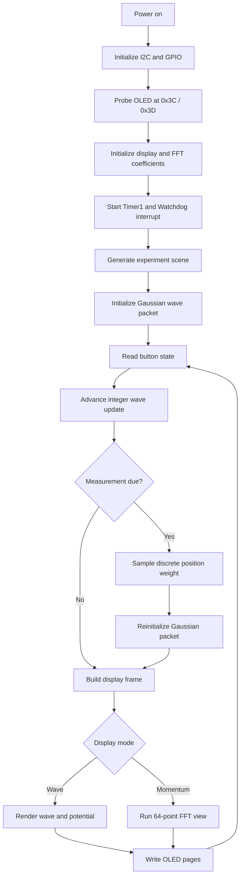

# QUANTA2 Technical Overview

## 1. Purpose and scope

QUANTA2 is a classical embedded simulation and visualization experiment for selected one-dimensional quantum-mechanics concepts. It runs on an ATmega328P-class Arduino UNO and displays the evolution of a compact complex wave packet and its configured potential landscape.

It is not quantum hardware and does not perform quantum computation. The source implements a simplified discrete numerical model. Quantitative scientific claims require independent verification.

## 2. Target platform and resource envelope

| Resource | Target |
|---|---:|
| MCU | ATmega328P |
| Clock | 16 MHz |
| Flash | 32 KB |
| SRAM | 2 KB |
| EEPROM | 1 KB |
| Grid | 128 spatial cells |
| Display | 128×64 I²C OLED |

The installation report records 12,204 bytes Flash and 1,564 bytes SRAM (484 bytes nominally remaining). Treat these as reported historical build figures, not a fresh measurement of every revision.

## 3. State representation

The spatial domain contains `NX = 128` cells. The complex wavefunction is stored in two signed 16-bit arrays:

- `re[NX]`: real component.
- `im[NX]`: imaginary component.

The potential is stored in `pot[NX]` as signed 8-bit samples. The source sets the boundary values of the real and imaginary arrays to zero during packet initialization, corresponding to hard-wall endpoints in the intended model.

Additional arrays hold potential-rendering heights, OLED page data, momentum bars, and FFT coefficients. A union reuses scratch memory for FFT and display operations.

## 4. Model conventions and initialization

The source comments specify dimensionless conventions:

- `ħ = 1`
- `m = 1`
- `Δx = 1`
- `Δt = 1/4`
- `V = pot/32`

The `packet(x0, s, k)` routine constructs a Gaussian-shaped packet centered at `x0`, with width parameter `s` and momentum parameter `k`. It computes a scale factor using a target discrete norm of approximately `5 × 10^7`.

These are implementation conventions and scaling choices. They do not establish convergence, physical-unit calibration, or accuracy.

## 5. Experiment construction

The `scene()` routine clears the potential array, selects parameters, configures display scaling, and initializes the packet. The eight modes are:

| Mode | Source-level construction |
|---|---|
| Tunneling | A single positive barrier near the center |
| Resonance | Two positive barriers separated by a gap |
| Quantum well | A negative potential region |
| Potential step | A positive potential on the right half |
| Oscillator | A position-dependent quadratic-like potential |
| Bragg crystal | A periodic sequence of positive potential samples |
| Disorder | Randomized potential samples over a region |
| Quantum bouncer | A position-dependent increasing potential |

Several parameters are varied between generated scenes. Therefore, repeated runs need not use identical potential values unless a deterministic test harness is added.

## 6. Time evolution

The `step()` routine performs two sequential passes:

1. Update the real component using neighboring imaginary-component samples and the local potential.
2. Update the imaginary component using neighboring real-component samples and the local potential.

The implementation uses integer arithmetic, shifts, and in-place array updates to fit the MCU's resource limits.

**Numerical caution:** the update is not yet established as a unitary propagator. In-place sequential updates can have stability and ordering consequences. The source's normalization alarm checks whether the total squared amplitude is outside a broad interval (40,000,000 to 60,000,000); this is a guard, not a proof of probability conservation or accuracy.

Before scientific interpretation, compare the implementation against a trusted reference solver and measure norm drift, phase error, energy behavior, boundary effects, and time-step sensitivity.

## 7. Momentum-space view

The `kspace()` routine computes a 64-point radix-2 FFT visualization:

- Every second spatial sample is selected.
- Input indices are bit-reversed.
- Iterative butterfly stages use precomputed trigonometric coefficients.
- Intermediate values are scaled to limit overflow.
- A compact magnitude approximation is converted into display bars.

This is intended as a compact visual representation. The displayed bars should not be treated as a calibrated momentum probability density until normalization, frequency ordering, sampling, and amplitude scaling are independently verified.

## 8. Measurement and statistics

The `measure()` routine:

1. Computes discrete weights `re[x]^2 + im[x]^2`.
2. Sums the weights.
3. Draws a pseudo-random threshold.
4. Selects the first position whose cumulative weight exceeds that threshold.
5. Updates counters.
6. Reinitializes a Gaussian packet centered at the selected position.

The sampling step is inspired by the Born rule for position probabilities. The post-selection state is a newly initialized Gaussian packet, not a rigorously derived projection of the pre-measurement state. Documentation and UI should describe it as a simplified measurement-inspired model.

The displayed left/right indicators are integer-scaled estimates derived from the two half-domain sums. They are visualization values rather than a substitute for a fully specified measurement/statistics pipeline.

## 9. Random-number mechanism

The source combines a Watchdog Timer interrupt, the free-running Timer1 counter, a 32-bit state pool, and Xorshift-style mixing.

This is not a certified hardware random-number generator. No entropy rate, bias, correlation, or min-entropy assessment is included. Do not use it for cryptographic keys, security tokens, or other security-sensitive purposes.

A future revision should separate entropy collection from deterministic PRNG state, define the threat model, and add statistical tests and health checks if randomness quality is a project requirement.

## 10. Display and interaction pipeline

The display uses the Arduino `Wire` interface at a configured 400 kHz clock. The firmware probes `0x3C` and `0x3D`, sends a compact initialization sequence, and renders eight 8-pixel pages.

The drawing path builds a potential/energy panel and either a real-wave trace or momentum bars. Text glyphs are stored in program memory to reduce SRAM use.

Button handling is implemented in the main loop:
- A short press advances the current timing/measurement cycle.
- A longer press toggles the wave/momentum view.

D9 is toggled for a short detector sound. D13 is used as a detector/status indicator and blinks if no display address is found.

The code contains SSD1306-style initialization commands and a configurable column offset. Physical SSD1306/SH1106 compatibility is not guaranteed for every module.

## 11. Runtime sequence

At startup, the firmware initializes I²C and GPIO, probes the OLED, sends initialization commands, calculates FFT coefficients, starts Timer1, and enables the Watchdog interrupt.

The main loop then:
1. Reads button state.
2. Creates the next experiment scene if required.
3. Advances the wavefunction several times per display frame.
4. Performs the measurement at the configured evolution boundary or on user input.
5. Advances the post-measurement display interval.
6. Renders the current state.

## 12. Engineering risks and priorities

| Risk | Why it matters | Priority |
|---|---|---|
| Numerical integrator not validated | May drift or distort physical behavior | Critical |
| Low remaining SRAM | Stack/interrupt pressure may cause instability | Critical |
| RNG entropy uncharacterized | Random outcomes may be biased or correlated | High |
| FFT display not reference-checked | Momentum view may be visually plausible but quantitatively wrong | High |
| OLED controller variance | Different modules may initialize differently | Medium |
| Integer scaling and rounding | Displayed probabilities and amplitudes are approximate | Medium |

## 13. Recommended next engineering step

Create a QUANTA2.1 validation branch before adding major features. Add deterministic test scenarios, a reference implementation on a desktop, runtime norm telemetry, SRAM/stack measurements, and hardware test records. Only then select a revised integrator or optimize the numerical kernel.

## 14. Related documentation

- [Numerical Methods](NUMERICAL_METHODS.md) explains the reference equation, the literal source-level update, measurement-inspired sampling, FFT limitations, and required scientific tests.
- [Reproducibility Guide](REPRODUCIBILITY.md) defines the pinned toolchain, clean-build command, upload procedure, and evidence levels.
- [Validation Plan](VALIDATION.md) records the current evidence and outstanding tests.

## 15. Firmware data flow

The following diagram summarizes the source-level runtime path. It is an architectural overview, not a timing or correctness guarantee.

## 16. Source and dependency boundary

The sketch includes the Arduino `Wire` interface and AVR program-memory/interrupt headers. The current repository source does not declare third-party Arduino libraries. The build therefore depends on the Arduino AVR platform and its bundled core/toolchain. If a future change adds an external library, document its exact name and version and update the CI and reproducibility instructions.

## 12. Firmware variant boundary

The current repository source is the eight-scenario implementation. A separate five-experiment source and two additional eight-experiment snapshots are preserved under `firmware/archive/` for provenance and independent compilation. See [Firmware Variants](FIRMWARE_VARIANTS.md). Do not combine feature lists or apply one variant's memory figures to another. The installation report refers to a different source SHA-256 than the canonical repository sketch; see [Deployment Evidence](DEPLOYMENT_EVIDENCE.md).
